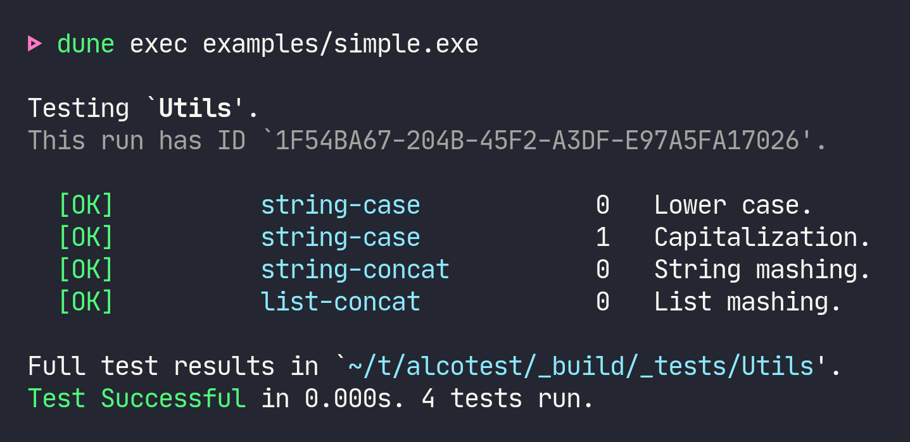
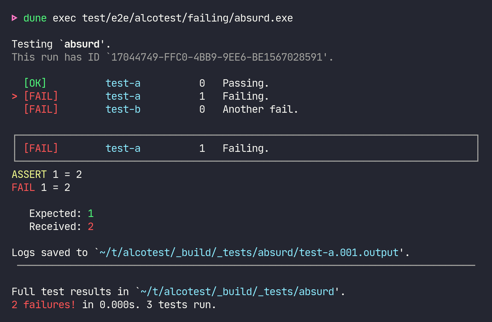

<p align="center"></p>
<p align="center"><b>A lightweight and colourful test framework.</b></p>
<br/>

Alcotest exposes a simple interface to perform unit tests. It exposes
a simple `TESTABLE` module type, a `check` function to assert test
predicates and a `run` function to perform a list of `unit -> unit`
test callbacks.

Alcotest provides a quiet and colorful output where only faulty runs
are fully displayed at the end of the run (with the full logs ready to
inspect), with a simple (yet expressive) query language to select the
tests to run. See [the manpage](./alcotest-help.txt) for details.

The API documentation can be found [here][docs]. For information on
contributing to Alcotest, see [CONTRIBUTING.md](./CONTRIBUTING.md).

[](https://ci.ocamllabs.io/github/mirage/alcotest)
[][docs]

[docs]: https://mirage.github.io/alcotest/alcotest/Alcotest/index.html

This fork imports the ISC-licensed 1.9.1 release. It maintains the
native Unix runner, portable engine and standard-library helpers. The upstream
Async, Lwt, Mirage and JavaScript package families are outside this fork's
package scope.

<hr/>

### Examples

A simple example (taken from `examples/simple.ml`):

<p align="center"></p>

Generated by the following test suite specification:

<!-- $MDX file=examples/simple.ml,part=example -->
```ocaml
(* A module with functions to test *)
module To_test = struct
  let lowercase = String.lowercase_ascii
  let capitalize = String.capitalize_ascii
  let str_concat = String.concat ""
  let list_concat = List.append
end

(* The tests *)
let test_lowercase () =
  Alcotest.(check string) "same string" "hello!" (To_test.lowercase "hELLO!")

let test_capitalize () =
  Alcotest.(check string) "same string" "World." (To_test.capitalize "world.")

let test_str_concat () =
  Alcotest.(check string)
    "same string" "foobar"
    (To_test.str_concat [ "foo"; "bar" ])

let test_list_concat () =
  Alcotest.(check (list int))
    "same lists" [ 1; 2; 3 ]
    (To_test.list_concat [ 1 ] [ 2; 3 ])

(* Run it *)
let () =
  Alcotest.run "Utils"
    [
      ( "string-case",
        [
          Alcotest.test_case "Lower case" `Quick test_lowercase;
          Alcotest.test_case "Capitalization" `Quick test_capitalize;
        ] );
      ( "string-concat",
        [ Alcotest.test_case "String mashing" `Quick test_str_concat ] );
      ( "list-concat",
        [ Alcotest.test_case "List mashing" `Slow test_list_concat ] );
    ]
```

The native executable is run and its volatile log identifiers are normalized:

```sh
$ CI=false ALCOTEST_COLUMNS=80 ./examples/simple.exe --color=never > full.out
$ ./test/e2e/strip_randomness.exe full.out
Testing `Utils'.
This run has ID `<uuid>'.

  [OK]          string-case            0   Lower case.
  [OK]          string-case            1   Capitalization.
  [OK]          string-concat          0   String mashing.
  [OK]          list-concat            0   List mashing.

Full test results in `<build-context>/_build/_tests/<test-dir>'.
Test Successful in <test-duration>s. 4 tests run.
```

The result is a self-contained binary which displays the test
results. Use `dune exec examples/simple.exe -- --help` to see the
runtime options.

Here's an example of a failing test suite:

<p align="center"></p>

By default, only the first failing test log is printed to the console
(and all test logs are captured on disk). Pass `--show-errors` to
print all error messages.

### Using Alcotest with opam and Dune

Add `(alcotest :with-test)` to the `depends` stanza of your
`dune-project` file, or `"alcotest" {with-test}` to your opam file.
Use the `with-test` [package variable][with-test] to declare your
tests opam dependencies. Call opam to install them:

Run `opam install --deps-only --with-test .`.

You can then [declare your test][tests] and link with Alcotest: `(test
(libraries alcotest …) …)`, and run your tests:

Run `dune runtest`.

[with-test]: https://opam.ocaml.org/doc/Manual.html#pkgvar-with-test
[tests]: https://dune.readthedocs.io/en/stable/tests.html#custom-tests

### Selecting tests to execute

You can filter which tests to run by supplying a regular expression
matching the names of the tests to execute, or by passing a regular
expression _and_ a comma-separated list of test numbers (or ranges of
test numbers, e.g. `2,4..9`):

```sh
$ CI=false ALCOTEST_COLUMNS=80 ./examples/simple.exe test --color=never '.*concat.*' > concat.out
$ ./test/e2e/strip_randomness.exe concat.out
Testing `Utils'.
This run has ID `<uuid>'.

  [SKIP]        string-case            0   Lower case.
  [SKIP]        string-case            1   Capitalization.
  [OK]          string-concat          0   String mashing.
  [OK]          list-concat            0   List mashing.

Full test results in `<build-context>/_build/_tests/<test-dir>'.
Test Successful in <test-duration>s. 2 tests run.
$ CI=false ALCOTEST_COLUMNS=80 ./examples/simple.exe test --color=never 'string-case' '1..3' > one.out
$ ./test/e2e/strip_randomness.exe one.out
Testing `Utils'.
This run has ID `<uuid>'.

  [SKIP]        string-case            0   Lower case.
  [OK]          string-case            1   Capitalization.
  [SKIP]        string-concat          0   String mashing.
  [SKIP]        list-concat            0   List mashing.

Full test results in `<build-context>/_build/_tests/<test-dir>'.
Test Successful in <test-duration>s. 1 test run.
```

Note that you cannot filter by test case name (i.e. `Lower case` or
`Capitalization`), you must filter by test name & number instead.

See the [examples][] directory for more examples.

[examples]: https://github.com/mirage/alcotest/tree/main/examples

### Quick and Slow tests

In general you should use `` `Quick`` tests: tests that are ran on any
invocations of the test suite. You should only use `` `Slow`` tests
for stress tests that are ran only on occasion (typically before a
release or after a major change). These slow tests can be suppressed
by passing the `-q` flag on the command line, e.g.:

```sh
$ CI=false ALCOTEST_COLUMNS=80 ./examples/simple.exe --color=never -q > quick.out
$ ./test/e2e/strip_randomness.exe quick.out
Testing `Utils'.
This run has ID `<uuid>'.

  [OK]          string-case            0   Lower case.
  [OK]          string-case            1   Capitalization.
  [OK]          string-concat          0   String mashing.
  [SKIP]        list-concat            0   List mashing.

Full test results in `<build-context>/_build/_tests/<test-dir>'.
Test Successful in <test-duration>s. 3 tests run.
```

### Passing custom options to the tests

In most cases, the base tests are `unit -> unit` functions. However,
it is also possible to pass an extra option to all the test functions
by using `'a -> unit`, where `'a` is the type of the extra parameter.

In order to do this, you need to specify how this extra parameter is
read on the command-line, by providing a [Cmdliner term][] for
command-line arguments which explains how to parse and serialize
values of type `'a` (*note:* do not use positional arguments, only
optional arguments are supported).

[Cmdliner term]: https://erratique.ch/software/cmdliner/doc/Cmdliner/Term/index.html

For instance:

<!-- $MDX file=examples/with_args/main.ml -->
```ocaml
let test_nice i = Alcotest.(check int) "Is it a nice integer?" 42 i

let number =
  let doc = "What is your preferred number?" in
  Cmdliner.Arg.(required & opt (some int) None & info [ "n" ] ~doc ~docv:"NUM")

let () =
  Alcotest.run_with_args "foo" number
    [ ("all", [ ("nice", `Quick, test_nice) ]) ]
```

This produces an executable that accepts `-n`, including with the explicit
`test` subcommand:

```sh
$ ./examples/with_args/main.exe test > missing.out 2>&1
[124]
$ ./test/e2e/strip_randomness.exe missing.out
Usage: main.<ext> test [--help] [OPTION]… [NAME_REGEX] [TESTCASES]
main.<ext>: required option -n is missing
$ CI=false ALCOTEST_COLUMNS=80 ./examples/with_args/main.exe test --color=never -n 42 > nice.out
$ ./test/e2e/strip_randomness.exe nice.out
Testing `foo'.
This run has ID `<uuid>'.

  [OK]          all          0   nice.

Full test results in `<build-context>/_build/_tests/<test-dir>'.
Test Successful in <test-duration>s. 1 test run.
```

### Native test logs

On Unix, the native runner retains each suite's latest started run and its
most recently completed failing run, together with every run still active.
A physical directory named by a run's UUID remains that run's diagnostic
identity. The suite and `latest` links are conveniences, rather than the
identity of a result.

The runner validates its registered output before retiring a superseded,
completed run. Kernel leases protect active runs; retention follows their
state rather than an age or a fixed number of directories. Unmarked output
from earlier versions is left untouched, as are foreign or symlinked
outputs that fail validation.

This retirement applies to the native Unix runner. Windows and runners
constructed with the existing `Core.Make` and custom `Platform.MAKER`
contract retain their previous log lifecycle; the custom contract has no
completion callback.

### Comparison with other testing frameworks

The README is pretty clear about that:

> Alcotest is a lightweight and colourful test framework.

Alcotest is the only testing framework using colors!

More seriously, Alcotest is similar to [ounit][] but it fixes a few of
the problems found in that library:

- Alcotest has a nicer output, it is easier to see what failed and
  what succeeded and to read the log outputs of the failed tests;

- Alcotest uses combinators to define pretty-printers and comparators
  between the things to test.

Other nice tools doing different kind of testing also exist:

- [qcheck][] does random generation and property testing (e.g. Quick
  Check);

- [crowbar][] and [bun][] are similar to qcheck, but use
  compiler-directed randomness, i.e. they take advantage of the AFL
  support the OCaml compiler;

- [ppx_inline_tests][] allows to write tests in the same file as
  your source-code; they will be run only in a special mode of
  compilation.

[ounit]: https://github.com/gildor478/ounit
[qcheck]: https://github.com/c-cube/qcheck
[crowbar]: https://github.com/stedolan/crowbar
[bun]: https://github.com/yomimono/ocaml-bun
[ppx_inline_tests]: https://github.com/janestreet/ppx_inline_test

### License

ISC. See [LICENSE.md](./LICENSE.md).
